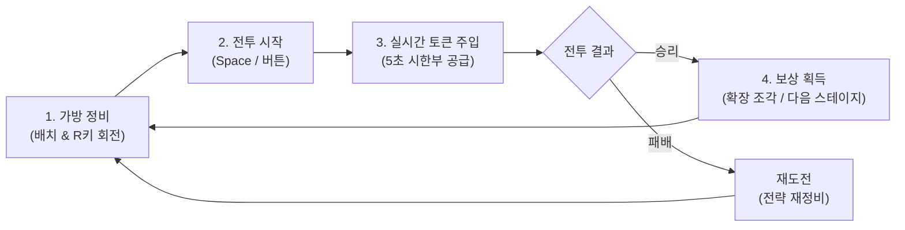

# 🎒 Inventory Auto Battle (인벤토리 오토 배틀러)

> **"가방 배치가 곧 전략이며, 신속한 토큰 공급이 승리를 부른다!"**  
> 제한된 6×6 인벤토리에 장비를 테트리스처럼 배치하고, 실시간 자동 전투 속에서 쏟아지는 5초 시한부 토큰을 장비에 신속히 주입하여 적을 무찌르는 전략 인벤토리 오토배틀러 게임입니다.

---

## 📖 게임 소개

**Inventory Auto Battle**은 전략적인 **인벤토리 퍼즐(Inventory Management)**과 긴장감 넘치는 **실시간 오토 배틀러(Real-time Auto-Battler)**가 결합된 하이브리드 게임입니다.

용사는 가방에 들어있는 장비의 힘으로 싸웁니다. 그러나 아무리 좋은 무기와 방패라도 에너지가 없으면 제 힘을 발휘하지 못합니다.  
플레이어는 전투 중 실시간으로 스폰되는 마력 토큰을 재빠르게 잡아 알맞은 장비에 밀어 넣어주어야 합니다. 5초 안에 토큰을 사용하지 못하면 허공으로 증발해버리므로, 빠른 판단력과 손놀림이 승패를 가릅니다!

---

## 🕹️ 조작 방법 (Controls)

직관적인 마우스 드래그 앤 드롭과 간단한 단축키로 모든 플레이가 가능합니다.

| 조작키 / 마우스 | 기능 | 상세 설명 |
|---|---|---|
| **마우스 좌클릭 & 드래그** | **아이템 / 토큰 이동** | • **정비 단계**: 인벤토리 내 장비를 드래그하여 최적의 위치로 이동 및 배치합니다. • **전투 단계**: 우측에 생성되는 토큰을 잡아 인벤토리의 해당 장비 위로 드래그하여 주입합니다. |
| **`R` 키** | **아이템 90° 회전** | 장비를 드래그하여 잡고 있는 도중 `R`키를 누르면 가로/세로 방향이 90도 회전합니다. |
| **`Space` 키 / 버튼 클릭** | **전투 시작** | 정비 단계(Ready)에서 화면 상단의 **'전투 시작'** 버튼을 누르거나 `Space`키를 눌러 전투(Battle)를 개시합니다. |
| **마우스 우클릭 (테스트/디버그)** | **가상 토큰 즉시 주입** | 인벤토리 아이템을 우클릭하면 해당 아이템에 필요한 토큰 1개가 즉시 주입되어 스킬 발동을 미리 테스트해 볼 수 있습니다. |

---

## 🔄 게임 플레이 방법 (How to Play)

게임은 **[1. 정비] ➔ [2. 전투] ➔ [3. 토큰 공급] ➔ [4. 보상 및 성장]**의 사이클로 진행됩니다.

### 1단계: 인벤토리 정비 (Preparation Phase)
- 6×6 격자 공간에 무기, 방패, 포션을 빈틈없이 효율적으로 배치하세요.
- 아이템을 잡고 옮길 때, 배치가 가능하면 **초록색**, 중복되거나 경계를 벗어나면 **빨간색**으로 테두리가 표시됩니다.
- 아이템을 잡은 채 **`R`키**를 눌러 가로/세로 형태를 바꿔 좁은 틈새를 채워 넣으세요.

### 2단계: 자동 전투 돌입 (Auto Battle Phase)
- 배치를 마친 뒤 **`Space`키** 또는 **'전투 시작'** 버튼을 누르면 전투가 시작됩니다.
- 플레이어와 적 캐릭터는 자동으로 서로에게 다가가 공격 쿨타임마다 기본 평타를 교환합니다.
- 캐릭터 스탯(공격력, 방어력, 보호막)에 따라 자동으로 피해량이 계산됩니다.

### 3단계: 실시간 토큰 주입 (Real-Time Token Action)
- 전투가 시작되면 우측 레일에 2초마다 마력 토큰이 생성됩니다.
- **수명 5초**: 토큰은 상단의 게이지가 줄어들며 5초가 지나면 사라집니다. 만료 1.5초 전부터는 깜빡이며 소멸을 경고합니다!
- 토큰을 신속하게 집어 해당 토큰을 요구하는 인벤토리 장비에 드래그 앤 드롭으로 주입하세요.
- 요구 개수를 모두 채운 장비는 **즉시 고유 스킬을 발동**하여 전황을 바꿉니다!

### 4단계: 스테이지 클리어 및 성장 (Reward Phase)
- 적의 체력을 0으로 만들면 스테이지 승리!
- 승리 시마다 **인벤토리 확장 조각**을 획득합니다.
- 조각 **3개**를 모으면 가방 공간이 확장되어 더 많은 장비를 장착할 수 있습니다.
- 다음 스테이지로 진입할수록 일반 몬스터부터 강력한 오크 대장까지 점진적으로 강한 적들이 등장합니다.

---

## 🗡️ 아이템 & 토큰 도감

### 1. 기본 장비 아이템

| 아이템 | 크기 | 요구 토큰 | 발동 효과 | 설명 |
|---|:---:|:---:|:---:|---|
| **초보자의 검** | 1×2 | ⚔️ 공격 토큰 2개 | **피해량 25** | 적에게 강력한 베기 공격을 가합니다. |
| **단검** | 1×1 | ⚔️ 공격 토큰 1개 | **피해량 15** | 작은 공간을 차지하며, 빠른 단타 공격을 가합니다. |
| **나무 방패** | 2×2 | 🛡️ 방어 토큰 2개 | **보호막 +20** | 체력 대신 피해를 먼저 흡수하는 보호막을 생성합니다. |
| **체력 물약** | 1×1 | ❤️ 회복 토큰 1개 | **체력 회복 +25** | 위기 상황에서 플레이어의 HP를 즉각 회복시킵니다. |

### 2. 마력 토큰

| 토큰 종류 | 상징 색상 | 주입 가능 장비 | 주요 역할 |
|---|:---:|:---:|---|
| **⚔️ 공격 토큰 (Attack)** | 빨강 | 검, 단검, 무기류 | 적에게 즉각적인 추가 타격을 가해 전투를 빠르게 끝냅니다. |
| **🛡️ 방어 토큰 (Defense)** | 파랑 | 방패류 | 피해를 막아줄 보호막을 생성하여 생존율을 대폭 올립니다. |
| **❤️ 회복 토큰 (Heal)** | 초록 | 물약, 회복류 | 감소한 체력을 즉시 보충하여 위기를 탈출합니다. |

---

## 💡 승리를 위한 공략 팁 (Strategy Tips)

1. **토큰 소멸을 방치하지 마세요**:  
   토큰이 생성된 후 5초가 지나 소멸하면 그만큼 화력과 생존력이 낭비됩니다. 깜빡이기 시작한 토큰부터 우선적으로 장비에 꽂아 넣으세요.
2. **보호막은 빠를수록 좋습니다**:  
   방패의 보호막은 피해를 미리 흡수해주므로, 방어 토큰이 나오면 방패에 우선 투자하여 체력 손실을 사전에 차단하세요.
3. **가방 공간의 회전 활용**:  
   1×2 크기의 검이나 2×2 크기의 방패는 `R`키로 적절히 회전시키면 구석의 남는 칸에 1×1 단검이나 물약을 딱 맞게 배치할 수 있습니다.
4. **확장 조각 누적**:  
   3번 승리할 때마다 인벤토리 확장 혜택이 주어지므로, 초반 스테이지를 안정적으로 클리어해 가방 용량을 키우는 것이 핵심입니다.

---

## 🚀 게임 시작 방법 (Getting Started)

1. **Unity Editor**에서 프로젝트를 엽니다. (권장 버전: Unity 6 / 6000.3.x)
2. 프로젝트 창에서 메인 씬을 엽니다:
   - 📂 경로: `Assets/_Project/Scenes/MainScene.unity`
3. 상단의 **Play(▶)** 버튼을 누르면 즉시 게임을 플레이할 수 있습니다.
4. *(참고)* 상단 메뉴 바의 `InventoryAutoBattle` ➔ `Build Final Main Scene`을 클릭하면 언제든 기본 통합 씬을 깨끗하게 새로 구성할 수 있습니다.
