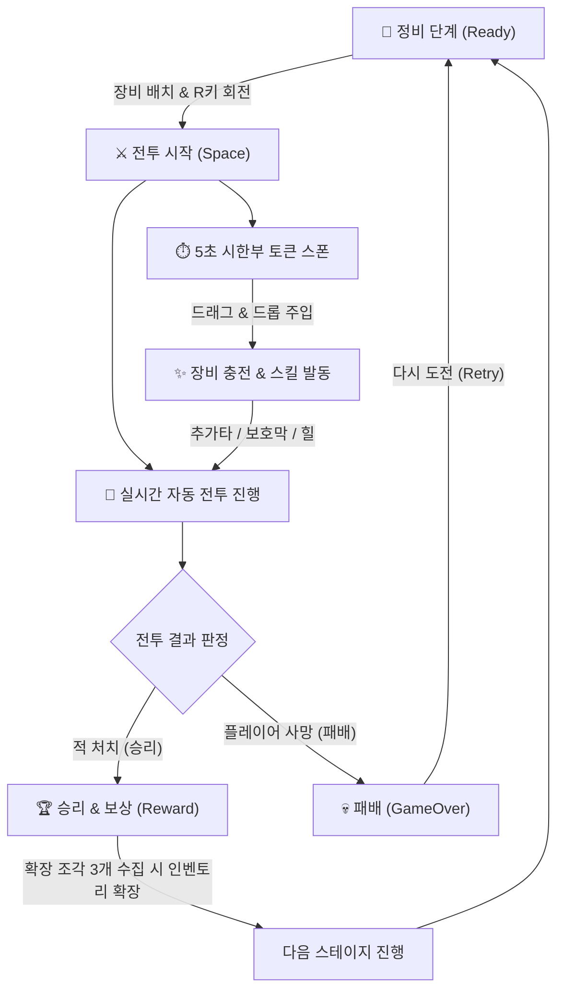

# 🎒 Inventory Auto Battle (인벤토리 오토 배틀러)

> **"전투 전에는 치밀한 가방 정리, 전투 중에는 긴박한 토큰 공급!"**  
> 제한된 6×6 인벤토리 공간에 장비를 전략적으로 테트리스식 배치하고, 실시간 자동 전투 중에 생성되는 5초 시한부 토큰을 장비에 신속히 주입하여 적을 무찌르는 전략 오토배틀러 게임입니다.

---

## 🎮 게임 소개

**Inventory Auto Battle**은 **'인벤토리 관리(Backpack Hero류 테트리스 퍼즐)'**와 **'실시간 자동 전투(Auto-Battler) + 토큰 주입 액션'**이 융합된 하이브리드 전략 게임입니다.

1. **정비 페이즈 (Ready)**: 보유한 다양한 크기(1×1, 1×2, 2×2 등)의 장비들을 회전(R키)시키며 인벤토리에 최적으로 배치합니다.
2. **전투 페이즈 (Battle)**: 캐릭터들이 자동으로 이동하고 타격하는 동안, 우측 컨베이어에 실시간으로 **공격(⚔️)·방어(🛡️)·회복(❤️)** 토큰이 스폰됩니다.
3. **토큰 실시간 공급**: 토큰은 **5초 후 자동 소멸**하므로, 신속하게 마우스로 드래그하여 알맞은 장비에 밀어 넣어야 합니다!
4. **장비 효과 발동**: 필요 토큰 개수를 채운 장비는 즉시 고유 효과(강력한 공격, 방어막, 체력 회복)를 터뜨려 전투의 전세를 뒤집습니다.
5. **성장과 보상 (Reward)**: 스테이지 승리 시 인벤토리 확장 조각을 획득하며, 스테이지가 거듭될수록 더 강력한 적이 등장합니다.

---

## 🕹️ 조작 방법 (Controls)

| 조작 | 기능 | 상세 설명 |
|---|---|---|
| **마우스 좌클릭 & 드래그** | **아이템 / 토큰 이동** | • 인벤토리 내 장비 아이템을 잡아 원하는 칸으로 이동<br>• 우측 토큰을 잡아 인벤토리의 해당 장비 위로 드래그 앤 드롭하여 주입 |
| **R 키** | **아이템 90° 회전** | 장비 아이템을 드래그하고 있는 상태에서 `R`키를 누르면 가로/세로 방향이 90도 회전합니다. |
| **Space 키 / 버튼 클릭** | **전투 시작** | 정비(Ready) 상태에서 '전투 시작' 버튼을 누르거나 `Space`키를 누르면 전투가 개시됩니다. |
| **마우스 우클릭 (디버그)** | **가상 토큰 즉시 충전** | 인벤토리 아이템을 우클릭하면 해당 아이템에 필요한 토큰이 즉시 충전되어 효과를 테스트해 볼 수 있습니다. |

---

## 🔄 게임 플레이 루프 (Core Gameplay Loop)



---

## 🧩 핵심 시스템 상세 설명

### 1. 6×6 격자 인벤토리 (`01_Inventory`)
- **테트리스식 그리드 배치**: 1×1(단검, 물약), 1×2(초보자의 검), 2×2(나무 방패) 등 다양한 크기의 아이템이 존재합니다.
- **실시간 충돌 감지 및 하이라이트**: 드래그 위치에 따라 유효한 배치는 **초록색**, 중복되거나 경계를 벗어나면 **빨간색**으로 시각적 피드백을 제공합니다.
- **아이템 회전(`R`키)**: 드래그 도중 `R`키를 눌러 가로/세로를 실시간으로 전환할 수 있습니다.
- **장비 스타터**: 게임 시작 시 검, 방패, 물약 등이 인벤토리에 기본 세팅됩니다.

### 2. 실시간 토큰 주입 시스템 (`02_Token`)
- **실시간 스폰**: 2초 주기로 공격, 방어, 회복 토큰이 랜덤 생성됩니다. (최대 5개 동시 유지)
- **5초 수명 타이머**: 각 토큰은 상단에 5초 원형/바 타이머가 작동하며, **1.5초 이하**로 남으면 깜빡이며 소멸을 경고합니다.
- **타입 매칭 인터페이스(`ITokenReceiver`)**: 장비가 요구하는 타입과 일치하는 토큰만 주입할 수 있으며, 일치하지 않으면 원래 자리로 튕겨 돌아갑니다.

### 3. 자동 전투 & 실시간 스킬 발동 (`03_Combat`)
- **자동 AI 교전**: 플레이어와 적이 서로에게 접근하여 공격 쿨타임마다 기본 평타를 주고받습니다.
- **방어력 및 보호막 공식**: 순수 데미지에서 방어력을 감산하며, 방패 스킬로 얻은 보호막(Shield)이 체력보다 먼저 피해를 흡수합니다.
- **토큰 연계 스킬**:
  - ⚔️ **무기 (검/단검)**: 공격 토큰 충전 시 적에게 즉각 대미지 타격
  - 🛡️ **방패**: 방어 토큰 충전 시 플레이어에게 추가 보호막 부여
  - ❤️ **물약**: 회복 토큰 충전 시 플레이어 체력 즉각 회복

### 4. 게임 루프 & HUD UI (`04_GameLoop_UI`)
- **유한 상태 머신(FSM)**: `Ready` ➔ `Battle` ➔ `Reward` / `GameOver`의 명확한 상태 기반 흐름.
- **HUD 인터페이스**:
  - 상단 스테이지 번호 및 적 이름/상태 배너
  - 플레이어 및 적 실시간 HP 바 (보호막 수치 동시 표기)
  - 인벤토리 잔여 빈 슬롯 카운터
  - 인벤토리 확장 조각 게이지 (3개 완충 시 인벤토리 확장 연출)
- **난이도 스케일링**: 스테이지가 올라갈수록 적의 체력, 공격력, 쿨타임이 점진적으로 강화됩니다.

---

## 📂 프로젝트 구조 및 씬(Scene) 안내

```text
Assets/_Project/
├── 00_Core/              # 공통 데이터(ItemData, TokenData, StageData) 및 전역 이벤트 버스(GameEvents)
│   └── Editor/           # 통합 씬 빌더 (MainSceneBuilder.cs)
├── 01_Inventory/         # 6×6 인벤토리 그리드, 슬롯, 아이템, 스타터
├── 02_Token/             # 실시간 토큰 생성기, 5초 타이머 및 드래그 주입
├── 03_Combat/            # 플레이어/적 엔티티, 자동 이동 및 전투 로직
├── 04_GameLoop_UI/       # GameManager(FSM), StageManager, UIManager, HUD
└── Scenes/
    └── MainScene.unity   # 🚀 [최종 통합 씬] 실제 게임 플레이용 메인 씬
```

### 🎬 실행 가능한 씬 목록

1. **`Assets/_Project/Scenes/MainScene.unity`** ⭐ **(추천)**
   - 인벤토리 + 토큰 + 전투 + 게임루프/HUD가 모두 연동된 **최종 완성형 게임 씬**입니다.
   - 에디터 상단 메뉴 `InventoryAutoBattle` ➔ `Build Final Main Scene`을 통해 언제든 자동 재구성이 가능합니다.

2. **개별 모듈 테스트 씬 (Sandbox Scenes)**:
   - `Assets/_Project/01_Inventory/Scenes/Dev1_Inventory_Test.unity`: 인벤토리 드래그, R키 회전, 빈 슬롯 계산 단독 테스트
   - `Assets/_Project/02_Token/Scenes/Dev2_Token_Test.unity`: 5초 토큰 스폰, 타이머 소멸 연출, 더미 타겟 주입 테스트
   - `Assets/_Project/03_Combat/Scenes/Dev3_Combat_Test.unity`: 플레이어/적 자동 전투, 대미지/보호막/힐 수치 단독 테스트
   - `Assets/_Project/04_GameLoop_UI/Scenes/Dev4_GameLoop_Test.unity`: W(강제승리), L(강제패배), P/E(피격) 등 FSM 및 UI 단독 테스트

---

## 🛠️ 개발 환경 및 기술 스택

- **Engine**: Unity 6 (6000.3.21f1)
- **Render Pipeline**: Universal Render Pipeline (2D URP)
- **Input System**: Unity New Input System (`com.unity.inputsystem`)
- **UI Framework**: Unity uGUI (Canvas Overlay & World 2D 연동)
- **Architecture**:
  - 모듈 간 직접 참조를 일절 배제한 **`GameEvents` 정적 C# Action 이벤트 버스(Event-driven Architecture)**
  - 각 기능 단위의 완결성을 보장하는 **프리팹 기반 모듈러 설계**
