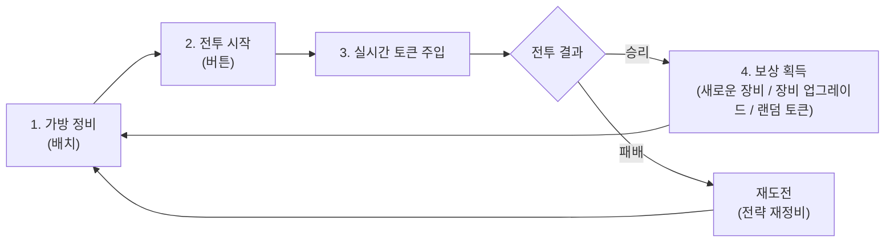
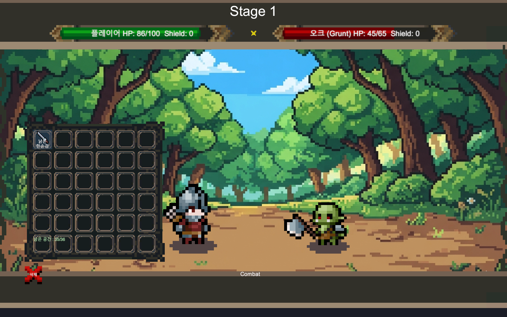
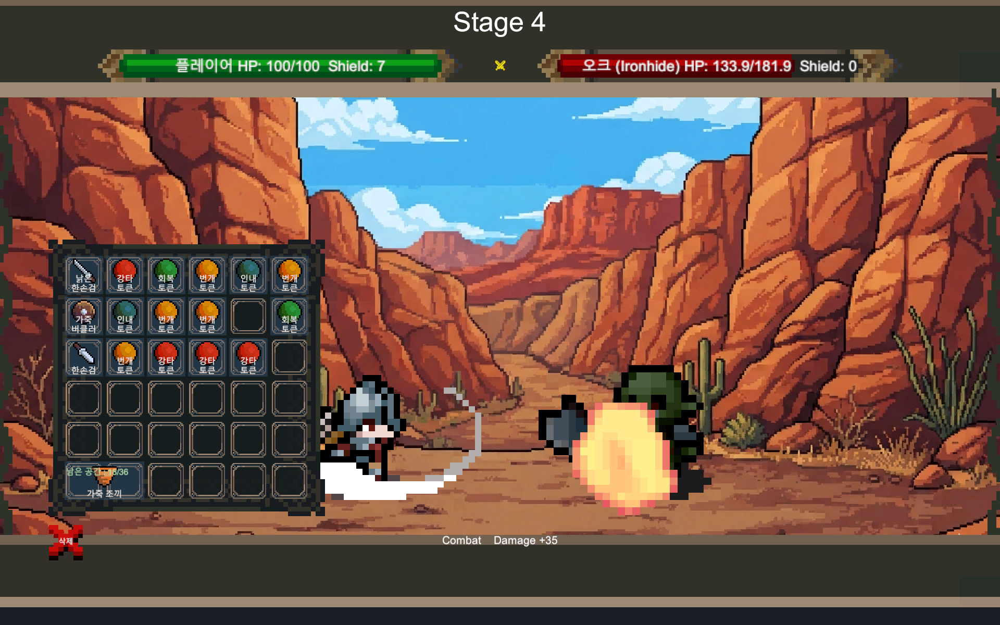

# 🎒 Inventory Auto Battle (인벤토리 오토 배틀러)

> **"가방 배치가 곧 전략이며, 신속한 토큰 공급이 승리를 부른다!"**  
> 제한된 6×6 인벤토리에 장비를 테트리스처럼 배치하고, 실시간 자동 전투 속에서 쏟아지는 토큰을 신속히 사용하여 적을 무찌르는 전략 인벤토리 오토배틀러 게임입니다.

---

## 📖 게임 소개

**Inventory Auto Battle**은 전략적인 **인벤토리 퍼즐(Inventory Management)**과 긴장감 넘치는 **실시간 오토 배틀러(Real-time Auto-Battler)**가 결합된 하이브리드 게임입니다.

용사는 가방에 들어있는 장비의 힘으로 싸웁니다. 
플레이어는 전투 중 마력 토큰을 재빠르게 잡아 알맞은 때에 사용하여야 합니다. 스테이지를 진행할수록 적이 강력해지므로, 빠른 판단력과 손놀림이 승패를 가릅니다!

---

## 😀 팀원 소개
| 이름 | 역할 |
|---|---|
| 이준상 | 개발 |  
| 정문길 | 기획 |  
| 김예슬 | 기획 |  
| 김우찬 | 기획 |  

---

## 🕹️ 조작 방법 (Controls)

직관적인 마우스 드래그 앤 드롭과 간단한 단축키로 모든 플레이가 가능합니다.

| 조작키 / 마우스 | 기능 | 상세 설명 |
|---|---|---|
| **마우스 좌클릭 & 드래그** | **아이템 / 토큰 이동** | • **정비 단계**: 인벤토리 내 장비를 드래그하여 최적의 위치로 이동 및 배치합니다. • **전투 단계**: 우측에 생성되는 토큰을 잡아 인벤토리의 해당 장비 위로 드래그하여 주입합니다. |

---

## 🔄 게임 플레이 방법 (How to Play)

게임은 **[1. 정비] ➔ [2. 전투] ➔ [3. 토큰 공급] ➔ [4. 보상 및 성장]**의 사이클로 진행됩니다.

### 1단계: 인벤토리 정비 (Preparation Phase)
- 6×6 격자 공간에 무기, 방패, 포션을 빈틈없이 효율적으로 배치하세요.

### 2단계: 자동 전투 돌입 (Auto Battle Phase)
- 배치를 마친 뒤 **'전투 시작'** 버튼을 누르면 전투가 시작됩니다.
- 플레이어와 적 캐릭터는 자동으로 서로에게 다가가 공격 쿨타임마다 기본 평타를 교환합니다.
- 캐릭터 스탯(공격력, 방어력, 보호막)에 따라 자동으로 피해량이 계산됩니다.

### 3단계: 토큰 사용 (Real-Time Token Action)
- 전투가 시작되면 토큰을 사용할 수 있습니다.
- 토큰을 신속하게 집어 플레이어 또는 적에게 드래그 앤 드롭으로 사용하세요.

### 4단계: 스테이지 클리어 및 성장 (Reward Phase)
- 적의 체력을 0으로 만들면 스테이지 승리!
- 보상으로 새로운 아이템과 스텟 업그레이트 토큰을 선택하세요.
- 랜덤으로 생성되는 5개의 토큰 중 필요한 토큰을 인벤토리로 가져오세요.
- 다음 스테이지로 진입할수록 일반 몬스터부터 강력한 오크 대장까지 점진적으로 강한 적들이 등장합니다.

---

## 🗡️ 아이템 & 토큰 도감

### 1. 기본 장비 아이템

| 아이템 | 크기 | 발동 효과 | 설명 |
|---|:---:|:---:|:---:|
| **기본 무기** | 1×1 | **피해량 5** | 적에게 베기 공격을 가합니다. |

이외의 무기들은 직접 플레이하며 확인해보세요!

### 2. 마력 토큰

| 토큰 종류 | 상징 색상 | 주요 역할 |
|---|:---:|:---:|
| **⚔️ 공격 토큰 (Attack)** | 빨강 | 적에게 즉각적인 추가 타격을 가해 전투를 빠르게 끝냅니다. (적 대상 사용) |
| **⚡ 번개 토큰 (Attack)** | 노랑 | 적에게 매우 강한 추가 타격을 가해 전투를 빠르게 끝냅니다. (적 대상 사용) |
| **😣 인내 토큰 (Defense)** | 파랑 | 피해를 받으면 꾹 참아 생존율을 대폭 올립니다. (플레이어 대상 사용) |
| **🛡️ 방어 토큰 (Attack)** | 보라 | 피해를 막아줄 보호막을 생성하여 생존율을 대폭 올립니다. (플레이어 대상 사용) |
| **❤️ 회복 토큰 (Heal)** | 초록 | 감소한 체력을 즉시 보충하여 위기를 탈출합니다. (플레이어 대상 사용) |

---

## 💡 승리를 위한 공략 팁 (Strategy Tips)

1. **토큰을 방치하지 마세요**:  
   전투 시에 적극적으로 토큰을 사용하세요. 
2. **보호막은 빠를수록 좋습니다**:  
   방패의 보호막은 피해를 미리 흡수해주므로, 방어 토큰이 나오면 우선 투자하여 체력 손실을 사전에 차단하세요.
3. **가방 공간의 정리**:  
   1×2 크기의 검이나 2×2 크기의 방패 등 다양한 크기의 아이템이 있으니 승리를 위하여 지속적인 정리가 필요합니다.

---
## 게임 다운로드
https://github.com/Jvncyo/InventoryAutoBattle/releases/tag/v1.0

---

## 🚀 게임 시작 방법 (Getting Started)

1. 다운로드한 파일을 압축을 풀어줍니다.
2. InventoryAutoBattle.exe를 실행해줍니다.
---

## 스크린샷

---

## 🎨 에셋 출처 (Assets & Credits)

본 게임은 아래의 무료/유료 에셋을 활용하여 제작되었습니다.

| 분류 | 에셋 이름 | 제작자 (Author) | 라이선스 |
|---|---|---|---|
| **캐릭터 / 몬스터** | [Tiny RPG Character Asset Pack 01 V2.0](https://zerie.itch.io/tiny-rpg-character-asset-pack) | Zerie | - |
| **아이템 / 아이콘** | [16x16 RPG Item Pack](https://alexs-assets.itch.io/16x16-rpg-item-pack) | Alex's Assets | CC0 1.0 Universal |
| **UI** | [Dark Ages UI - Pixel Art Asset Pack](https://hypnobius.itch.io/dark-ages-ui) | Hypnobius | - |
| **이펙트** | [750 Effect and FX Pixel All](https://bdragon1727.itch.io/750-effect-and-fx-pixel-all) | BDragon1727 | - |
| **사운드 / BGM** | [Minifantasy - Dungeon Audio Pack](https://leohpaz.itch.io/minifantasy-dungeon-sfx-pack) | Leohpaz | - |